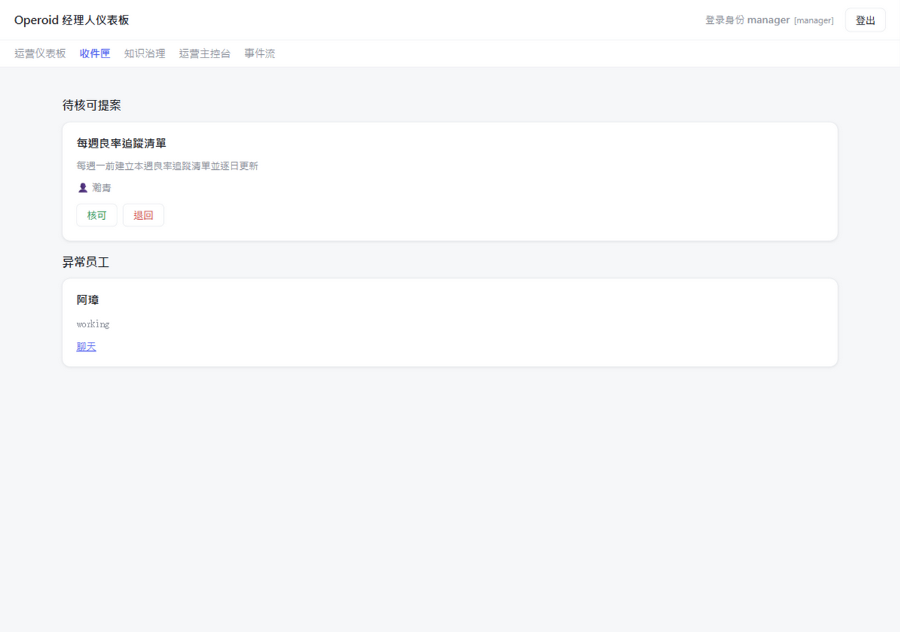
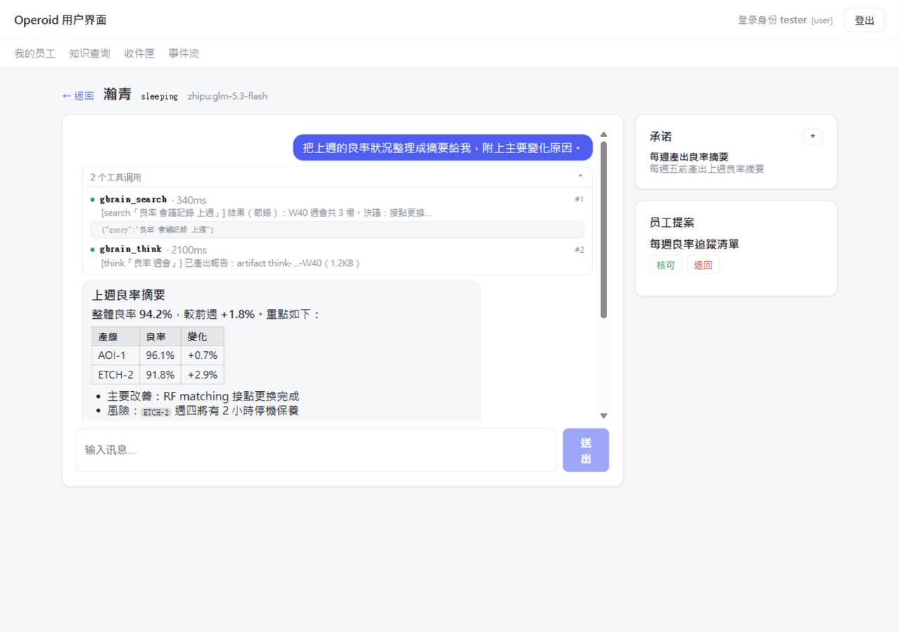

# Operoid

[English](README.md) | [繁體中文](README.zh-TW.md) | **简体中文**

> **能被公司信任的 AI 员工。**
>
> Operoid 是开源的 **AI Agent 操作系统**：AI 代理——**Employee 员工**——在共享的
> **工作空间（Workspace）**里承担持久的职责，并且始终在"由人类画定、由服务器
> 强制执行、事后可稽核"的边界内工作。

以 **Rust**（常驻服务＋Tauri v2 桌面壳）与 **Vue 3 + TypeScript** 打造，
跑在你自己的硬件上。
**作者：** 朱国栋 (Charlie Chu) · **授权：** [MIT](#授权)

---

## 为什么需要 Operoid？

今天所有主流的 Agent 产品，都已经能在你关掉窗口后继续工作——调度触发、持久记忆、
常驻执行环境。"持续运作"已经是**标配**。

真正没有解决的，是每一位管理者真正想问的问题：***我凭什么让它做？*** 它到底被允许
做什么？被允许知道什么？当它做错了，谁来负责？

今天的 AI 像一位出色的**顾问**：给完建议就离开。它在公司里没有身份、没有授权范围、
决策出错也无从问责——所以 AI 在职场上，始终只能活在小小、被紧盯着的窗口里。

**员工**不一样：员工加入组织、承担成果、持续负责。要让 AI 做到同样的事，它需要
任何一位新进员工都需要的东西：

- 一个由组织核发——也随时可收回——的**身份**；
- 一份写明"不必请示就能做什么"的**委任**；
- 一张写明"可以知道什么"的**权限**；
- 以及它经手的每件事都留下的**记录**。

Operoid 把这四件事全部做成**架构，而不是价目表上的企业版加购**——以开源核心、
跑在数据所在的地方：你自己的机器，或公司自己的内网。

## 给 AI 代理的操作系统

Operoid 对 AI 代理的关系，就像操作系统对程序：它提供环境，不做程序的工作。

| 操作系统概念 | 在 Operoid 里 |
|---|---|
| **进程** | **Employee 员工** —— 被调度、执行与暂停的代理 |
| **文件** | **Artifact 成果物** —— 由工作空间拥有、而非由对话拥有的持久产出 |
| **内存** | **工作记忆与知识** —— 依需求恢复，而非长期驻留 |
| **设备** | **Tool 工具** —— 通过受控界面调用的外部能力 |
| **内核（kernel）** | **Runtime 执行引擎** —— 唤醒 Employee、恢复上下文、让它工作、再让它休眠 |

Runtime 管理**执行**，从不管理**思考** —— Employee 想什么，是它自己的事。
这就是为什么 Operoid 是操作系统，而不是应用程序。

## 治理，做进架构里

### 人类画得出的委任界线

"该不该让 AI 决策？"其实不是一个问题，而是三个：系统能否正确决策（**能力提问**）？
决策失准时，责任落在谁身上（**问责提问**）？这一类决策，是否本来就应由人类作出
（**正当性提问**）？只有第一问的答案会随技术移动。

Operoid 把界线当成宪法——由人类画定——并以**动作类别登记表（Action Registry）**
将它操作化：授权以**动作类别**为单位，绝不授权给"系统"；**从严预设**、会届期、
须重签，事故后**自动冻结**。

### 知道"谁在问"的知识

同一个脑、同一个查询、不同身份 → **不同结果**。授权发生在**检索之前**，由确定性的
服务器代码评估——永不交给 LLM，没有任何"先取回再遮蔽"。政策缺失或损坏＝
**拒绝（fail closed）**。而每一次特权检索都留下一张**收据**：谁、在哪个任务、
依哪版政策、看到哪些。

### 每位员工都有身份，也都有记录

每位 Employee 以自己的 token 认证——身份出自 token 链，永不出自调用端的自称。
每一件工作成果都是可版本化的 **Artifact**，归工作空间所有，不归对话。
长期的职责成为 **Commitment**：挺得过重启、失败自动重试、连续失败后
**交回人类处理**——而不是默默坏掉。



## Operoid 有什么不同

Agent 市场分成四类。他们都宣称"持续运作"；组织治理则是另一回事：

|  | 个人 AI 助理 | 开发者 Agent 工具 | 云端"AI 员工"SaaS | **Operoid** |
|---|---|---|---|---|
| 为谁而建 | 个人 | 工程师 | 业务团队 | **公司与团队** |
| 跑在哪 | 你的机器 | 你的终端机 | 供应商的云 | **你的机器或公司内网** |
| 不在场也持续工作 | ✓ | 有限 | ✓ | ✓ |
| 委任界线——AI 不必请示能做什么 | ✗ | ✗ | 企业版加购 | **架构——以动作类别为单位、由人类画定** |
| 检索前强制执行的知识权限 | ✗ | ✗ | 部分、仅限云端 | **fail closed、服务器强制** |
| 代理身份与审计轨迹 | ✗ | ✗ | 企业版加购 | **内置——每个特权行为都留收据** |
| 开源 | ✓ | ✓ | ✗ | ✓ · MIT |

## 实际上长什么样

Employee 因触发而醒来——调度、进来的 Email、经理人的消息——恢复上下文，在
自己的沙箱工作区里工作（读文件、改文件、执行命令、查询知识，全部在**你**控制的
模板级授权之下），然后回去休眠。在对话里，你看得见它工作：每个工具调用、
它的参数、花了多久——以及一份干净的 Markdown 回复。当决策超出它的授权，
它不猜测：它提案，由人类核可。



文档也会变成知识——连图一起。双栏论文、扫描报告、满是图表的简报，被解析成
章节切块、可检索的笔记，每张图都是独立的检索项。以一篇真实 IEEE 论文基准：
**十二道针对特定图表的问题，前五名命中 12/12（MRR 0.90）**——走的是生产检索
管线。默认本地——第三方云在明确 opt-in 之前一律挡下。

## Operoid 现在能做到什么

架构手册的路线图已**一路实现至 Phase 7**（截至 **v0.5.0**）——五个里程碑全部完成：

1. ✅ **一个真正能工作的 Employee** —— 因 Trigger 唤醒、恢复上下文、调用工具、提交成果物、休眠。
2. ✅ **持久化** —— 工作能挺过完全关机与重启。
3. ✅ **共享的 Brain 与知识** —— 升级一个 Brain，多个 Employee 同步采用。
4. ✅ **模板与实例** —— 一个模板，多个独立员工。
5. ✅ **协作** —— 一群 Employee 合作完成一个 Project。

也已出货：看得见过程的对话（每个工具调用的参数、耗时、结果）、Email 与 IM
直达同样的员工（[obridge](obridge/)）、知识图谱地基、上述文档管线，以及把
[Claude Code](https://claude.com/claude-code) 作为第一个代理入口。
完整全貌——概念、原则、路线图——见**[架构手册](handbook/Chinese/README.md)**。

## 一套代码，两种版本

| | 个人版 | 企业版 |
|---|---|---|
| 资产 | 桌面安装文件 | `operoid-enterprise-*` 部署包 |
| 执行位置 | 用户自己的电脑 | 公司内网服务器 |
| 设置 | 安装即用 | 一条引导式指令：`oserver configure` |
| 访问 | 桌面 app | 浏览器：`/admin` `/manager` `/user`——密码登录＋角色式权限 |

选配能力（知识图谱引擎、本机嵌入、复杂 PDF 解析）都会被自动侦测，并以能力矩阵
呈现在应用程序内；安装细节见 **[DEPLOYMENT.md](DEPLOYMENT.md)**。

## 开始使用

- **个人版**——到 [**Releases** 页面](https://github.com/ascetic168/Operoid/releases)
  下载安装文件执行即可，无须构建。
- **企业版**——从同一个 Release 下载部署包，执行 `oserver configure`：
  引导式向导会检查前置需求、设置 TLS、创建管理员帐号，并可选注册开机服务。
  完整流程见 **[DEPLOYMENT.md](DEPLOYMENT.md)**。
- **从源码**——需要 **Rust 工具链**与
  [Tauri v2 前置需求](https://v2.tauri.app/start/prerequisites/)：

  ```bash
  git clone https://github.com/ascetic168/Operoid.git
  cd Operoid
  npm install
  npm run tauri dev    # 执行应用（热重载）
  ```

  开发指令：`npm run build`（前端类型检查＋构建）、`cargo test`／`cargo check`
  （Rust workspace）。改动 `oserver`／`obridge` 时请用 `cargo dev-build`
  两个一起编——服务以 sibling 方式带起 `obridge`，并会互相核对 build id。

## 深入阅读

- **[架构手册](handbook/Chinese/README.md)**——这套系统的宪法：概念、原则与背后的
  推理（[第二十一章——路线图](handbook/Chinese/21-Roadmap.md)）。
- **[DEPLOYMENT.md](DEPLOYMENT.md)**——前置需求、降级行为，与两种版本的部署。
- **[界线的形状](journal/界线的形状_朱国栋.pdf)**——动作类别登记表背后的论文，
  从一个真实（已去识别化）的制造业个案蒸馏而来。
- 问题与反馈：开一个 [GitHub issue](https://github.com/ascetic168/Operoid/issues)。

## 授权

本项目以 **[MIT 授权](LICENSE)** 发布。
Copyright © 2026 朱国栋 (Charlie Chu)。完整条文见 [LICENSE](LICENSE)。
